# OhMyOrch


OhMyOrch is a Claude Code plugin that delivers a `SPECS.md` backlog with OpenSpec, one story at a time.

<https://josoroma.github.io/OhMyOrch/docs/OhMyOrch.html>

[Plugin handbook](plugins/ohmyorch/README.md) · [Installation & updates](docs/distribution.md)

Watch the walkthrough, From Spec to Delivery. It was recorded for 0.0.1, before the flow became the four steps shown below.

[](https://www.youtube.com/watch?v=vLKeNAXPPd8)

[**Watch the walkthrough: From Spec to Delivery**](https://www.youtube.com/watch?v=vLKeNAXPPd8)

Give Claude a READY story. The main session proposes, applies, verifies and archives one OpenSpec change, then marks the story DONE.

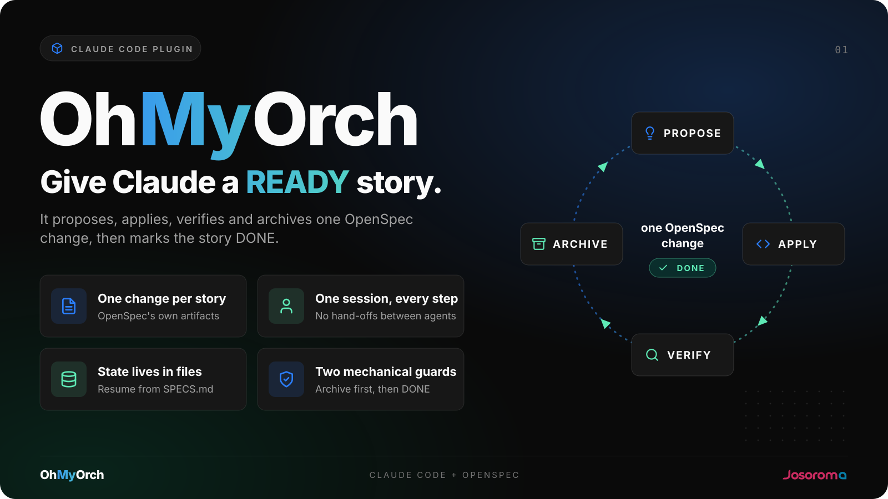

## How delivery works

Each READY story becomes one OpenSpec change, and the main session takes it through four steps:

```text
SPECS.md READY story
   -> propose   /ohmyorch:opsx-propose   proposal.md, specs/, design.md (only when needed), tasks.md
   -> apply     /ohmyorch:opsx-apply     implement the tasks, tick them in tasks.md
   -> verify    /ohmyorch:opsx-verify    advisory check of the implementation against the change
   -> archive   openspec archive <id> -y merges the delta specs, moves the change to changes/archive/
   -> story marked DONE in SPECS.md
```

Run the whole loop with `/ohmyorch:deliver <target>`, where the target is an epic (`EPIC-1`), a story (`US-1.1`) or a task (`US-1.1#2`). The slide shows the command behind each step and the six actions the loop can derive.

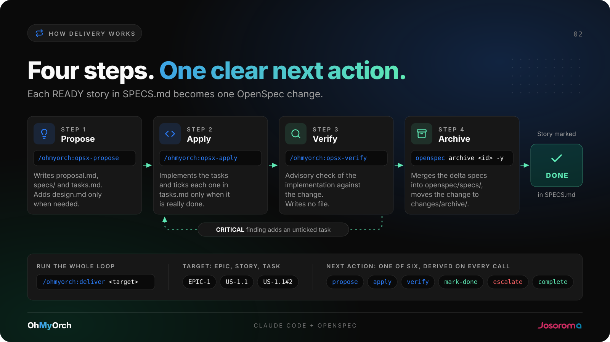

- A change's record is OpenSpec's own artifacts. `tasks.md` is the only progress tracker.
- Verify writes no file. A CRITICAL finding becomes a new unticked task, which returns the change to apply.
- Two guards are mechanical: `openspec archive` is refused while `tasks.md` has unticked tasks, and a story cannot become DONE while its change is still active.

The next action is derived from `SPECS.md` and the change directory on every call, so a new session resumes from the files, not from chat memory.

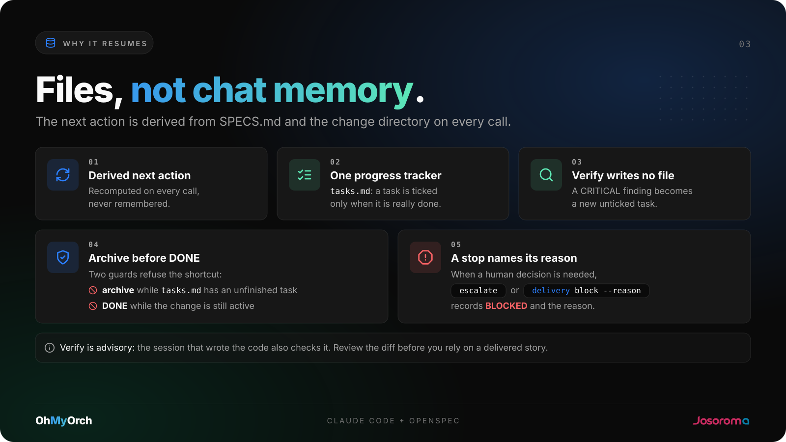

## Try it locally

**0.1.0 is the current source version; it is not tagged. The last tagged release is 0.0.1.** For a local preview, run from this repository:

```bash
claude --plugin-dir ./plugins/ohmyorch
```

Load the plugin from a checkout, check the project, and preview the bootstrap before you apply it.

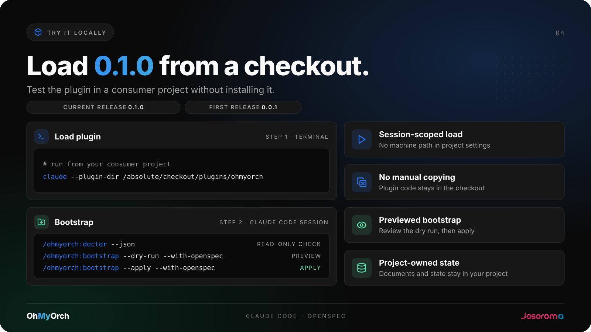

## Prepare, then deliver

Analyze the code, write or ingest the intent, deliver a READY story, and resume the goal when a session ends.

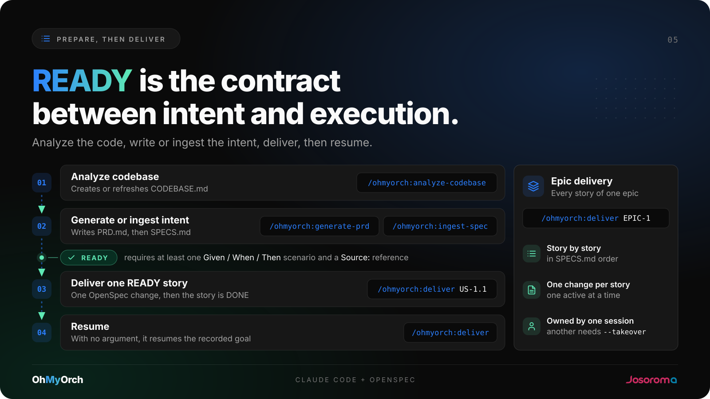

## Install and release status

The prerequisites, the marketplace commands, and the release gates that are still open. [Installation & updates](docs/distribution.md) has the details.

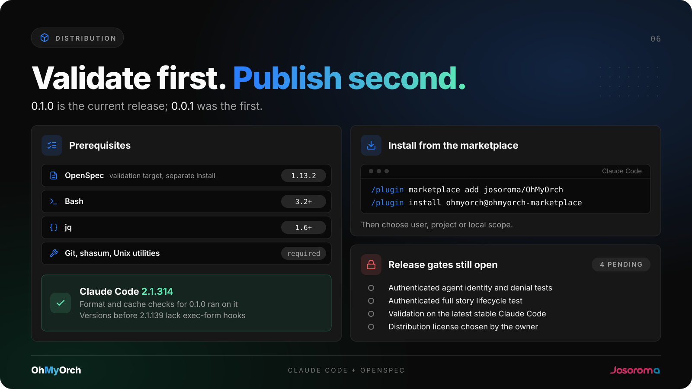

## What's included

The plugin has 18 skills (17 public commands and one internal contract), three read-only authoring agents for the PRD, SPECS and CODEBASE documents, root hooks and a Bash/jq runtime.

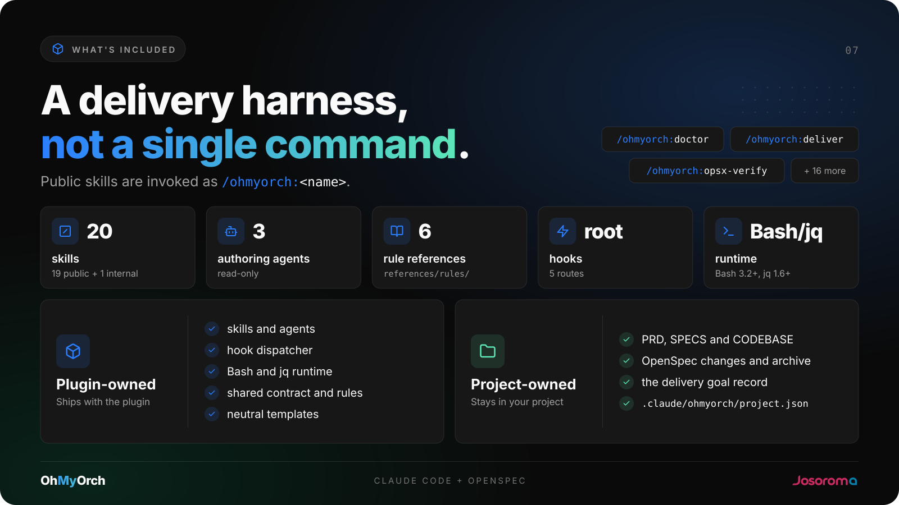

The 17 public skills, grouped by the job you need to do. The [guide](docs/OhMyOrch.md) describes each one.

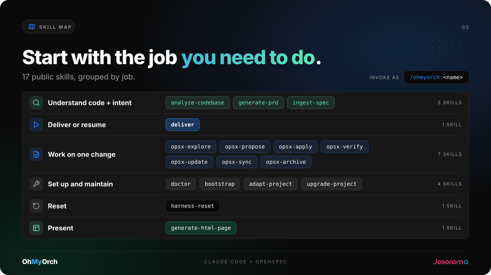

## Work on the plugin

The checks a maintainer runs in this repository, and what never reaches a packaged plugin.

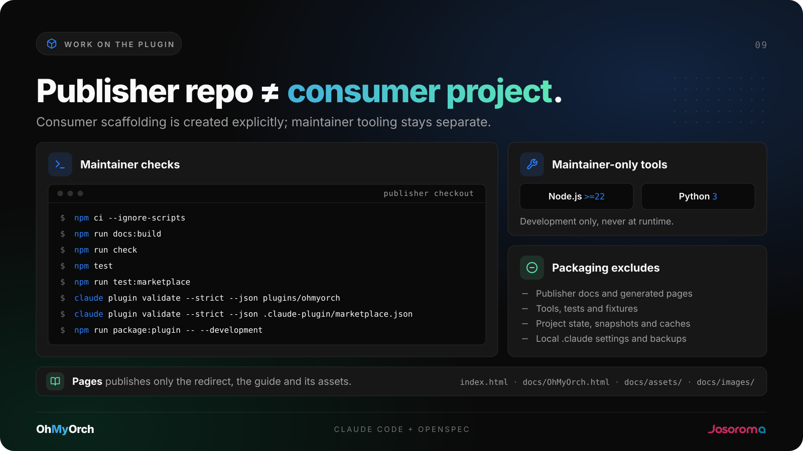

## What a delivered story leaves behind

A change leaves only OpenSpec's own artifacts: no plan, review, test-report or status files.

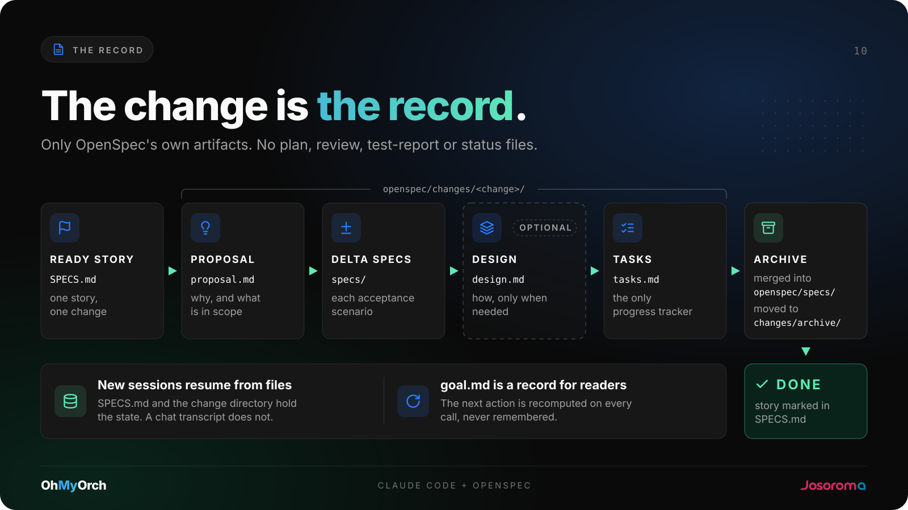

## See your specification as a workspace

[SPECS-APP.hml](SPECS-APP.hml) turns your backlog into a Kanban board. Open a story to see its criteria, tasks, and dependencies, or switch to Document for the complete specification.

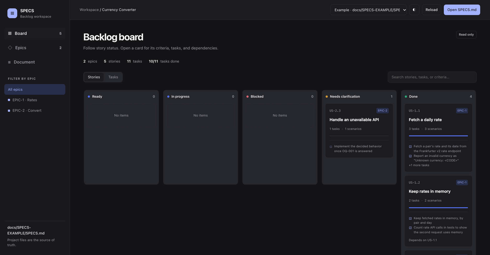

### Setup and run

Requires **Python 3**. The viewer needs no build step or Claude session.

```bash
git clone https://github.com/josoroma/OhMyOrch.git
cd OhMyOrch
python3 -c 'import http.server,mimetypes; mimetypes.add_type("text/html",".hml"); http.server.test(HandlerClass=http.server.SimpleHTTPRequestHandler,port=8000,bind="127.0.0.1")'
```

Already cloned? Run the Python command beside `package.json`. It serves `.hml` as HTML.

Open **[localhost:8000/SPECS-APP.hml](http://127.0.0.1:8000/SPECS-APP.hml)**. The app starts with your root `SPECS.md`; when that file is missing, it opens [the example backlog](docs/SPECS-EXAMPLE/SPECS.md). Use the file selector to switch between them.

### Use it

Switch between Stories, Tasks, and Epics; search or filter to focus on the work that matters. Document keeps the context and acceptance criteria visible, with a Markdown source view and download.

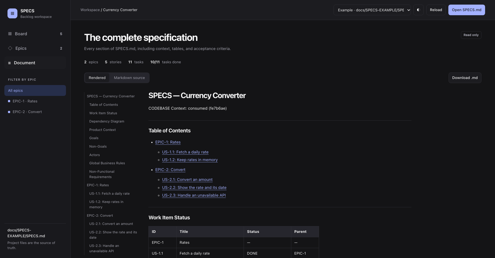

Edit the Markdown file, then click **Reload**. The workspace is read only: it never changes delivery status. **Open SPECS.md** also lets you inspect another local backlog.

The sample includes a matching [PRD](docs/SPECS-EXAMPLE/PRD.md) and [codebase context](docs/SPECS-EXAMPLE/CODEBASE.md).
