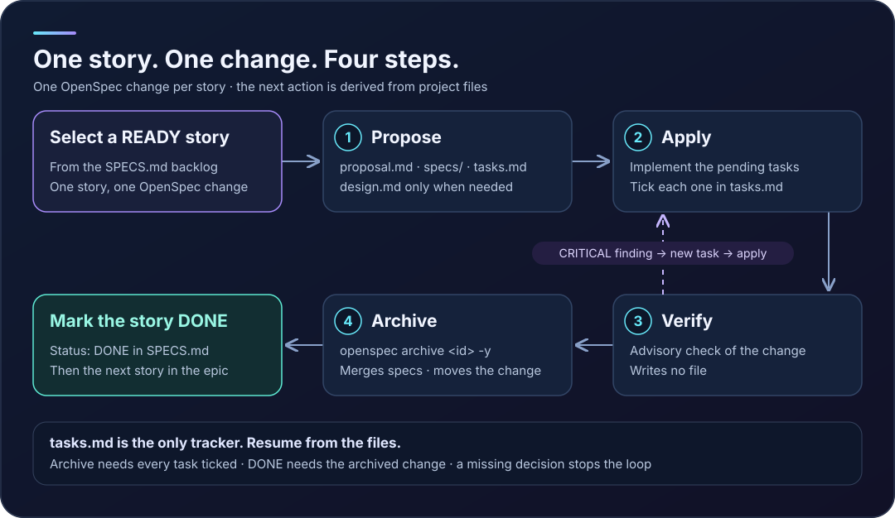
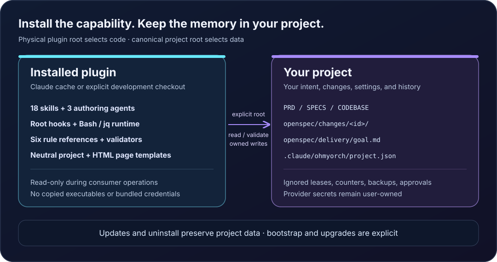

# OhMyOrch

[From Spec to Delivery: OpenSpec + OhMyOrch Workflow Explained](https://www.youtube.com/watch?v=vLKeNAXPPd8)


**Pick a READY story**

Propose it, apply it, verify it, archive it.

OhMyOrch brings a repeatable delivery loop to Claude Code. Each READY story in your `SPECS.md` backlog becomes one OpenSpec change. The main session proposes the change, applies its tasks, verifies the result, archives it, and marks the story DONE. The next action is always derived from project files, so you can see what is finished, what is pending, and where to resume.

OhMyOrch **0.1.0** is the version in this repository and its last tagged release; 0.0.1 was the first. The walkthrough video above was recorded for 0.0.1 and predates the propose, apply, verify, archive flow this guide describes. Authenticated delegated-agent/full-delivery tests and the distribution license remain gates for public packaged artifacts and support claims. The features below describe the implemented plugin; examples illustrate the workflow rather than claiming a completed live run.

## Why the loop is useful

A large goal gets a small working unit: one independently verifiable story, one change, one next action. An epic becomes a sequence of those changes. Task focus still carries the parent story's acceptance criteria.

The record is OpenSpec's own. A change holds `proposal.md`, delta `specs/`, `tasks.md` and, only when the change needs it, `design.md`. `tasks.md` is the only progress tracker: a task is ticked when it is really done.

Problems stay visible in the same files. A CRITICAL verify finding becomes a new unticked task, so the change returns to apply. A missing product decision becomes a blocker, and the loop stops for a human. A new session picks up from these files, not from chat memory.

### Start the whole loop with one command

In an initialized project, run **`/ohmyorch:deliver <target>`** in Claude Code. It reads the configured `SPECS.md` backlog and, for each story, proposes the change, applies its tasks, verifies the implementation, archives the change, and marks the story DONE. For example, to deliver an existing epic:

```text
/ohmyorch:deliver EPIC-1
```

Choose the scope that matches your backlog:

| Scope | Example command | What the loop delivers |
|---|---|---|
| Epic | `/ohmyorch:deliver EPIC-1` | Every story in that epic, in SPECS order; one OpenSpec change per story. |
| Feature / user story | `/ohmyorch:deliver US-1.1` | The bounded feature represented by that user story. |
| Task focus | `/ohmyorch:deliver US-1.1#2` | The parent story, with its second task prioritized; all story acceptance criteria still apply. |
| Task description | `/ohmyorch:deliver "Add the password-reset request endpoint"` | The parent story of a uniquely matching task, with that task recorded as the focus. |

These IDs and task text are examples; use targets that actually exist in your mapped `SPECS.md`. Feature selection uses the story's `US-N.M` ID. Stories must be READY with approved acceptance criteria and satisfied dependencies. The loop continues until the goal is COMPLETE or a blocker requires a human decision. Resolve the blocker and repeat the same command to resume.



## Start in a real project

Actual delivery needs an authenticated Claude Code session. Prerequisites are OpenSpec **1.13.2**, Bash **3.2+**, jq **1.6+**, Git, shasum, and standard Unix utilities. OpenSpec is installed separately and has its own Node requirements; the bundled plugin runtime uses Bash and jq.

Claude Code **2.1.292** is the recorded preferred validation target. For 0.0.1, format and isolated marketplace/cache checks passed on it and on **2.1.285**; for 0.1.0 they passed locally on **2.1.314**. Full live-agent validation is pending; these are recorded targets, not a claim about the newest available CLI.

With a checkout of this version, run from your consuming project:

```bash
claude --plugin-dir /absolute/checkout/plugins/ohmyorch
```

This loads the plugin for the session. During development, `/reload-plugins` reloads edited components. [Official development guidance](https://code.claude.com/docs/en/plugins/create#develop-without-a-marketplace).

For the actual local marketplace/cache flow, run from the consumer project:

```bash
claude plugin marketplace add /absolute/checkout --scope local
claude plugin install ohmyorch@ohmyorch-marketplace --scope local
```

To install from the repository marketplace:

```text
/plugin marketplace add josoroma/OhMyOrch
/plugin install ohmyorch@ohmyorch-marketplace
```

Choose local scope for a personal project trial, project scope for a team declaration, or user scope across projects. [Official plugin commands and scopes](https://code.claude.com/docs/en/plugins/cli-reference).

## Initialize deliberately

Installation loads code. Bootstrap creates scaffolding only when explicitly requested:

```text
/ohmyorch:doctor --json
/ohmyorch:bootstrap --dry-run --with-openspec
/ohmyorch:bootstrap --apply --with-openspec
```

Review the preview before applying. Existing PRD, SPECS, CLAUDE, README, OpenSpec configuration, and host scripts survive. Missing PRD/SPECS start neutral; CODEBASE comes from analysis. `--mode merge` adds an owned CLAUDE guidance block. Edited owned blocks produce a conflict rather than an overwrite.

Root, `docs/`, and mixed layouts work. If both locations contain a document, select it explicitly with `--prd`, `--specs`, and `--codebase` during bootstrap. Once created, `.claude/ohmyorch/project.json` governs the mapping. Doctor reports actual paths and prerequisite failures.

For an existing codebase:

```text
/ohmyorch:analyze-codebase
/ohmyorch:adapt-project --dry-run
/ohmyorch:adapt-project --apply
```

Analysis produces descriptive CODEBASE evidence. Adaptation creates owned project guidance from actual evidence and records unknowns. Nested guidance requires `--nested` and evidence for the directory. Surrounding human-authored text survives.

## Turn approved intent into READY work

Use `/ohmyorch:generate-prd` with human-approved requirements and `/ohmyorch:ingest-spec` with an approved source. Codebase observations explain what exists; product decisions define what should change. Missing behavior remains NEEDS CLARIFICATION or BLOCKED until a human resolves it.

Before a write to the mapped PRD or SPECS, a hook checks that the CODEBASE context is current. It refuses the write when the project has existing code but no CODEBASE document, or when files have changed since the revision that CODEBASE records. Run `/ohmyorch:analyze-codebase`, or record your decision in the document being written: `CODEBASE Context: skipped (<reason>)` when there is no CODEBASE document, or `CODEBASE Context: consumed (<revision>, staleness accepted)` for the recorded revision when it is stale. Commits that touch only the mapped PRD, SPECS, and CODEBASE do not make the analysis stale.

Delivery bookkeeping in SPECS never needs that check: `Status:` and `Change:` lines, task ticks, and the story and task rows of the `## Work Item Status` table. Adding, rewording, moving, or deleting a task line is a material edit and is checked.

Start when the selected story exists, is READY, has acceptance scenarios and source traceability, and its dependencies are satisfied. The following IDs are examples; choose real ones from your backlog:

```text
/ohmyorch:deliver US-1.1
```

An epic delivers its stories in backlog order, each with its own change:

```text
/ohmyorch:deliver EPIC-1
```

Task focus uses `/ohmyorch:deliver US-1.1#2` or a uniquely matching task description. The parent story still supplies acceptance; checking one task does not approve the story.

## Follow the four steps

The main session performs every step. Each step leaves its result in OpenSpec's own artifacts, and a change has no other files.

| Step | Command | What it leaves on disk |
|---|---|---|
| 1. Propose | `/ohmyorch:opsx-propose <change>` | `openspec/changes/<change>/` with `proposal.md`, delta `specs/`, `tasks.md` and, only when needed, `design.md`. The story becomes IN PROGRESS with a `Change:` line in SPECS. |
| 2. Apply | `/ohmyorch:opsx-apply <change>` | Product code and tests, with each finished task ticked in `tasks.md`. |
| 3. Verify | `/ohmyorch:opsx-verify <change>` | No new file. The report covers completeness, correctness, and coherence; a CRITICAL issue becomes an unticked task in `tasks.md`. |
| 4. Archive | `openspec archive <change> -y` | Delta specs merged into `openspec/specs/`, and the change moved to `openspec/changes/archive/`. The story is then marked DONE in SPECS. |

`/ohmyorch:opsx-explore` is optional. Use it only when a story or the affected code is unclear.

After every step, the session derives the next action again from SPECS and the change directory. There are six actions:

| Action | Derived when | What the session does |
|---|---|---|
| `propose` | The story has no change yet, or the change's planning artifacts are incomplete. | Creates the change, or authors only what is missing. |
| `apply` | `tasks.md` has an unticked task. | Implements the pending tasks and ticks each one. |
| `verify` | Every task is ticked. | Verifies the change; with no CRITICAL issue, archives it. |
| `mark-done` | The change is archived, no active directory has its id or is named for the story, and the story is not DONE. | Sets the story to DONE and points its `Change:` line at the archived change. |
| `escalate` | The story is not READY or IN PROGRESS, a dependency is unfinished, another change is still active, or the story's `Change:` line names an archived change while a directory named for the story is still active. | Stops and reports the decision a human must make. |
| `complete` | Every story in the goal is DONE. | Reports the result. |

Planning is complete when the change has `proposal.md`, at least one `.md` file under `specs/`, and a `tasks.md` with task checkboxes. `design.md` is never required, and a change whose `.openspec.yaml` declares `skip_specs: true` needs no `specs/`. Tasks are counted the way OpenSpec counts them: a checkbox with any marker other than `x` is unfinished. Only one change is active at a time. Stored goal text is a human record; current files govern the next step.

## Meet the three authoring agents

Skills are the commands you invoke. Delivery runs in the main session, without per-step agents. Three agents support the documents that come before delivery: each inspects and authors, and the calling skill persists what it returns. All three inherit the session's selected model and preload the shared `ohmyorch:contract`.

| Agent | Responsibility and handoff | Example entry point |
|---|---|---|
| [`ohmyorch:codebase-analyst`](../plugins/ohmyorch/agents/codebase-analyst.md) | Inspect actual code and return evidence-backed CODEBASE content. | `/ohmyorch:analyze-codebase` |
| [`ohmyorch:product-specifier`](../plugins/ohmyorch/agents/product-specifier.md) | Turn approved product sources into PRD content. | `/ohmyorch:generate-prd docs/approved-brief.md` |
| [`ohmyorch:spec-ingestor`](../plugins/ohmyorch/agents/spec-ingestor.md) | Return a source-traceable SPECS backlog with stories and acceptance scenarios. | `/ohmyorch:ingest-spec` |

Each agent has a Read/Grep/Glob/Bash tool budget, with no Write or Edit, and its prompt declares it read-only. The root hook dispatcher enforces the same rule for file tools: a Write, Edit, or MultiEdit from any `ohmyorch:*` agent is refused, so authored content returns to the main session.

Use the entry-point skills for routine work. Each one delegates to its agent and then writes the mapped document.

## Inspect without advancing

The CLI gives precise answers from the files. Run these in an initialized consumer project; set the plugin directory and change ID to actual values:

```bash
plugin_dir=/absolute/checkout/plugins/ohmyorch
project_root="$(pwd -P)"
change_id=your-change-id

"$plugin_dir/bin/ohmyorch" --project-root "$project_root" delivery next --json
openspec status --change "$change_id"
openspec list --json
```

These calls are read-only. `delivery next --json` prints one line for the recorded goal: its `target`, the derived `action`, the `story`, the `change`, the `command` to run, and the `reason`. Pass a target such as `US-1.1` after `next` to ask about work that has no goal yet. `openspec status --change` shows the state of each planning artifact; it lists `design.md` as not yet written for a change that has none, which is expected because design is optional. `openspec list --json` reports each active change with its completed and total task counts. Run the `openspec` commands from the project root.

Starting, refreshing, stopping, or blocking a goal uses the actual Claude session ID through `--session-id`. Skills supply explicit project/plugin/session context; ordinary Bash does not automatically receive the substitutions as environment variables. The [plugin handbook](../plugins/ohmyorch/README.md) covers direct mutation and recovery commands.

## Pause, repair, and resume

| Goal state | Meaning |
|---|---|
| ACTIVE | The owner session is driving the next derived action. |
| BLOCKED | A decision, an unfinished dependency, a failed derivation, or stalled progress needs attention. |
| STOPPED | Delivery was explicitly stopped. |
| COMPLETE | Every story in the selected goal is DONE. |

By default, three unchanged blocked Stop attempts precede the fourth unchanged Stop, which records BLOCKED and permits stopping. The counter belongs to the owner session. Another session's Stop does not drive your goal. Claude's continuation limits also apply. [Official Stop hook behavior](https://code.claude.com/docs/en/hooks).

When the session finds in the middle of a change that a human decision is missing, the derived action does not change, so the Stop hook would keep refusing the stop. The session records the decision needed with `delivery block --reason '<story id: the decision needed>'`, reports it, and stops; the goal becomes BLOCKED with that reason. The same applies when an OpenSpec step tells the session to pause, ask the user, or wait for guidance. This is only for a missing human decision, never for work that is merely hard.

Resume a resolved BLOCKED or STOPPED goal with `/ohmyorch:deliver` and the **same target**. Completed stories are not redone, because every step is derived from the repository. To redo a DONE story, set it back to READY with a new `Change:` id; with the same id it would be marked DONE again. An ownership conflict requires explicit `--takeover` from the session that takes over, using its actual session ID. No lease expiry is inferred. Notes you write between the AUTHORED markers in `openspec/delivery/goal.md` survive every refresh; the rest of that file is rewritten. Deleting runtime directories is not a resume procedure.

## Make the finish explicit

A story finishes in three moves, in this order:

1. **Verify is advisory.** `/ohmyorch:opsx-verify` reports on completeness, correctness, and coherence, and writes no file. A CRITICAL issue becomes a new unticked task in `tasks.md`, which returns the change to apply. In this loop two kinds of finding are CRITICAL whatever rank `/ohmyorch:opsx-verify` gives them: an acceptance scenario of the story that is not implemented, whose observed result contradicts its `Then`, or for which there is no observed evidence; and a project test that fails because of this change. A test that was already failing for an unrelated reason is reported, not turned into a task. A scenario counts as passing only with evidence the session actually observed.
2. **Archive needs every task ticked.** `openspec archive <id> -y` runs as a separate, standalone Bash call. A hook refuses it while `tasks.md` still has an unticked task. OpenSpec then validates the delta specs, merges them into `openspec/specs/`, and moves the change to `openspec/changes/archive/`. Invalid delta specs stop the archive.
3. **DONE needs the archive.** A SPECS edit that sets a story to `Status: DONE` is refused while that story's change is still active. After the archive, set the story to DONE and point its `Change:` line at the archived change.

An epic then moves to its next story.

## Know where files belong



| Location | Ownership |
|---|---|
| Installed plugin tree or Claude cache | Skills, agents, hooks, runtime, validators, references, neutral templates |
| Mapped PRD/SPECS/CODEBASE | Product intent, iterable backlog, descriptive codebase evidence |
| `openspec/changes/<id>/` | The active change: `proposal.md`, delta `specs/`, `tasks.md`, optional `design.md` |
| `openspec/specs/` and `openspec/changes/archive/` | Canonical specs merged at archive, and completed changes |
| `openspec/delivery/goal.md` | The recorded delivery goal: derived sections plus your authored notes |
| Project config, ledger, managed bases | Nonsecret configuration and owned guidance provenance |
| Ignored runtime/backups/local approval | Session lease/counters, affected-file recovery, approved script hash |

Update and uninstall preserve project documents/state. Initialization, adaptation, project upgrades, and reset are separate explicit operations. This publisher repository keeps consumer scaffolding in bundled templates for bootstrap into your project.

## Choose the right skill

There are **18 skills: 17 public commands and one internal contract**. Invoke public skills as `/ohmyorch:<name>`. The inventory below covers every installed skill and gives an example for each public command. IDs, change names, task descriptions, and source paths are illustrative; substitute actual approved project inputs.

### Initialize and maintain a project

Lifecycle changes are manually invoked. Preview first, inspect the proposed files, and apply the reviewed operation explicitly.

| Skill | Use it to… | Example |
|---|---|---|
| [`doctor`](../plugins/ohmyorch/skills/doctor/SKILL.md) | Report prerequisite, project, mapping, and interrupted-operation diagnostics. | `/ohmyorch:doctor --json` |
| [`bootstrap`](../plugins/ohmyorch/skills/bootstrap/SKILL.md) | Adopt existing documents and create missing neutral scaffolding. | `/ohmyorch:bootstrap --dry-run --with-openspec` |
| [`adapt-project`](../plugins/ohmyorch/skills/adapt-project/SKILL.md) | Create evidence-backed project guidance and owned blocks. | `/ohmyorch:adapt-project --dry-run --mode merge` |
| [`upgrade-project`](../plugins/ohmyorch/skills/upgrade-project/SKILL.md) | Preview a project-state upgrade or recover a retained lifecycle transaction. | `/ohmyorch:upgrade-project --dry-run` |
| [`harness-reset`](../plugins/ohmyorch/skills/harness-reset/SKILL.md) | Preview the ownership-based managed-guidance reset. | `/ohmyorch:harness-reset --scope managed --dry-run` |

### Understand intent and drive delivery

| Skill | Use it to… | Example |
|---|---|---|
| [`analyze-codebase`](../plugins/ohmyorch/skills/analyze-codebase/SKILL.md) | Create or refresh descriptive CODEBASE evidence. | `/ohmyorch:analyze-codebase` |
| [`generate-prd`](../plugins/ohmyorch/skills/generate-prd/SKILL.md) | Turn human-approved product source material into the mapped PRD. | `/ohmyorch:generate-prd docs/approved-brief.md` |
| [`ingest-spec`](../plugins/ohmyorch/skills/ingest-spec/SKILL.md) | Turn the PRD/approved sources into a traceable SPECS backlog. | `/ohmyorch:ingest-spec` |
| [`deliver`](../plugins/ohmyorch/skills/deliver/SKILL.md) | Drive or resume an epic, story, or task-focused goal through the whole loop. | `/ohmyorch:deliver EPIC-1` |

### Work on a selected change

These seven commands are the OpenSpec workflows under the plugin's namespace. Each takes an OpenSpec change ID; `opsx-explore` also accepts a story or an open question. `deliver` runs propose, apply, and verify for you as it advances. Use the commands directly when you work on a change by hand.

| Skill | Use it to… | Example |
|---|---|---|
| [`opsx-explore`](../plugins/ohmyorch/skills/opsx-explore/SKILL.md) | Think through an idea or clarify a story before proposing. Optional. | `/ohmyorch:opsx-explore US-1.1` |
| [`opsx-propose`](../plugins/ohmyorch/skills/opsx-propose/SKILL.md) | Create the change and author its proposal, delta specs, tasks and, when needed, design. | `/ohmyorch:opsx-propose add-password-reset` |
| [`opsx-update`](../plugins/ohmyorch/skills/opsx-update/SKILL.md) | Revise existing planning artifacts coherently from approved decisions. | `/ohmyorch:opsx-update add-password-reset` |
| [`opsx-apply`](../plugins/ohmyorch/skills/opsx-apply/SKILL.md) | Implement the pending tasks and tick each one in `tasks.md`. | `/ohmyorch:opsx-apply add-password-reset` |
| [`opsx-verify`](../plugins/ohmyorch/skills/opsx-verify/SKILL.md) | Check the implementation against the change for completeness, correctness, and coherence. Advisory. | `/ohmyorch:opsx-verify add-password-reset` |
| [`opsx-sync`](../plugins/ohmyorch/skills/opsx-sync/SKILL.md) | Merge a change's delta specs into the canonical specs without archiving. | `/ohmyorch:opsx-sync add-password-reset` |
| [`opsx-archive`](../plugins/ohmyorch/skills/opsx-archive/SKILL.md) | Archive a finished change interactively, with a spec-sync prompt. `deliver` uses the `openspec archive <id> -y` command instead. | `/ohmyorch:opsx-archive add-password-reset` |

### Explain and share the evidence

| Skill | Use it to… | Example |
|---|---|---|
| [`generate-html-page`](../plugins/ohmyorch/skills/generate-html-page/SKILL.md) | Build a sourced, self-contained page about status, architecture, or delivery. | `/ohmyorch:generate-html-page Explain the password-reset delivery and its evidence` |
| [`contract`](../plugins/ohmyorch/skills/contract/SKILL.md) | Supply the shared operational contract to skills and agents. | Internal preload: `ohmyorch:contract`; not a slash command. |

`generate-html-page` produces a self-contained themed page with evidence sources, light/dark modes, accessible SVGs, and a bundled validator. This public guide is a separate website with repository-hosted images and SVG assets.

The bundled CLI has 13 operations: `doctor`, `bootstrap`, `adapt-project`, `upgrade-project`, `harness-reset`, `delivery`, `validate-product-artifacts`, `validate-html-page`, `guard-context-preflight`, `guard-story-done`, `guard-archive`, `guard-delivery-loop`, and `run-project-validation`. Host fast validation is disabled by default; enable it explicitly and approve the reviewed script's current SHA-256. Changed/unapproved scripts are skipped.

## Walk through one feature

Suppose your approved product brief describes password reset, and ingestion produces a READY story `US-1.1` in `EPIC-1`. In your initialized consumer project:

1. Run `/ohmyorch:analyze-codebase` for an existing application. The analyst returns current-state evidence; the skill persists the mapped CODEBASE document.
2. Run `/ohmyorch:generate-prd docs/approved-brief.md`, then `/ohmyorch:ingest-spec`. Review the resulting intent, traceability, acceptance scenarios, and dependencies. Resolve missing decisions before marking work READY.
3. Run `/ohmyorch:deliver US-1.1`. The session proposes one change for the story: `proposal.md`, a delta spec with a scenario for every acceptance scenario of the story, and `tasks.md`. It sets the story to IN PROGRESS, then applies the tasks and ticks each one when it is done.
4. With every task ticked, the session verifies the change. A CRITICAL finding becomes a new task, and the loop returns to apply. With none, the session runs `openspec archive <change> -y`, marks the story DONE, and the goal becomes COMPLETE. Inspect the archived proposal, specs, and ticked tasks under `openspec/changes/archive/`, and the merged requirements under `openspec/specs/`.

For every story in that epic, choose `/ohmyorch:deliver EPIC-1`. To prioritize its second task while still delivering the parent story, choose `/ohmyorch:deliver US-1.1#2`. When a run is BLOCKED or STOPPED, resolve its cause and repeat the same target to resume from the derived next action. The guide's examples describe expected behavior; authenticated full-lifecycle evidence remains a release gate.

## Update or recover deliberately

```text
/plugin marketplace update ohmyorch-marketplace
/plugin update ohmyorch@ohmyorch-marketplace
/ohmyorch:upgrade-project --dry-run
/ohmyorch:adapt-project --dry-run
/ohmyorch:adapt-project --apply
```

Code update and project-state upgrade are separate. Review the latter before applying. Managed guidance changes only when you review and apply `/ohmyorch:adapt-project`. After updating from 0.0.1, the project's `CLAUDE.md` block and `.claude/rules/ohmyorch-*-standards.md` still describe the removed flow until you do, and `/ohmyorch:upgrade-project` does not change them. Adaptation also refreshes an `openspec/config.yaml` that is unchanged since bootstrap scaffolded it; an edited one is left alone and its old `context:` line must be changed by hand. The [changelog](../plugins/ohmyorch/CHANGELOG.md) gives that line under "Upgrading from 0.0.1", with the `delivery stop` step for a goal that is still owned and the step for an in-flight change with open review findings.

Reset defaults to owned managed guidance; full workflow reset is a separately reviewed scope:

```text
/ohmyorch:harness-reset --scope managed --dry-run
/ohmyorch:harness-reset --scope workflow --dry-run
```

Applied lifecycle operations report recovery IDs. Rollback verifies affected-file backups and current hashes, preserving subsequent edits. Recovery requires the retained backup directory; an ID alone cannot restore files. Read the [handbook](../plugins/ohmyorch/README.md) and [distribution guide](distribution.md) for scope-specific commands.

## Know the current boundaries

Root hooks use Claude's scoped identity fields for supported Write/Edit/MultiEdit payloads, intercept supported standalone archive commands, and evaluate only the owner's Stop events. They are workflow guardrails. Arbitrary Bash/MCP writes and renamed executables can bypass file-tool checks. The archive guard sees only the `openspec archive` command; a change archived any other way is not checked. PostToolUse reports findings after a write; it cannot undo it.

In an activated project the hooks do not judge a Write, Edit, or MultiEdit whose target is physically outside the project and Claude's plugin directory, so Claude's own plan, memory, and scratch files can be written. A path that reaches the project or the installed plugin by another route, such as a symbolic link or `..`, is refused, and so is a target that is itself a symbolic link.

Verify is advisory and is not independent evidence: the session that wrote the code also checks it. The two guards confirm only that every task is ticked before archive and that the change is archived before DONE. They do not show that a task was done well or that every scenario was exercised. A human reviews the diff before relying on a delivered story.

Native Windows, custom OpenSpec schemas, registered/global stores, and unsupported prospective file-tool payloads are outside this implementation's supported scope. Linux/macOS CI is configured; recorded local execution was macOS. Authenticated role identity/denials and the complete live lifecycle remain public release gates.

## Build and inspect the source

The plugin has one runtime under `plugins/ohmyorch/`. Six rule references sit beside the shared contract; skills and agents read them explicitly. It bundles no MCP server, global default agent, consumer permissions, or install-time project mutation.

Maintainers generate the HTML guide from this Markdown:

```bash
npm ci --ignore-scripts
npm run docs:build
npm run check
npm test
npm run test:marketplace
```

Documentation uses local assets and system fonts. Plugin packaging excludes publisher assets/tools/tests and all consumer state. Public packaging requires license and live-test evidence. See the [release workflow](../.github/workflows/plugin-release.yml).

## Sources

Features are defined by the current [delivery skill](../plugins/ohmyorch/skills/deliver/SKILL.md), [operational contract](../plugins/ohmyorch/references/contract.md), [delivery engine](../plugins/ohmyorch/scripts/delivery.sh), [archive guard](../plugins/ohmyorch/scripts/guard-archive.sh), [story guard](../plugins/ohmyorch/scripts/guard-story-done.sh), [root dispatcher](../plugins/ohmyorch/hooks/dispatch.sh), and [lifecycle engine](../plugins/ohmyorch/lib/lifecycle.sh). The seven `opsx-*` skills are the prompts OpenSpec 1.13.2 generates, with the plugin namespace and one boundary paragraph; see the [OpenSpec provenance note](../plugins/ohmyorch/references/openspec-provenance.md).

The [implementation record](plan/PLUGIN-IMPLEMENTATION.md) separates regression/cache evidence from pending authenticated tests. The [release checklist](plan/plugin-release-readiness.json) governs public packaged artifacts and support claims. Integration guidance comes from official [plugin development](https://code.claude.com/docs/en/plugins/create), [plugin commands](https://code.claude.com/docs/en/plugins/cli-reference), and [hooks](https://code.claude.com/docs/en/hooks) documentation.

The website uses the supplied [shadcn Luma preset](https://ui.shadcn.com/create?preset=b2D0wqNxT) light/dark tokens, with rounded surfaces, soft elevation, and open spacing informed by the official [Luma introduction](https://ui.shadcn.com/docs/changelog/2026-03-luma) and [theme conventions](https://ui.shadcn.com/docs/theming).
