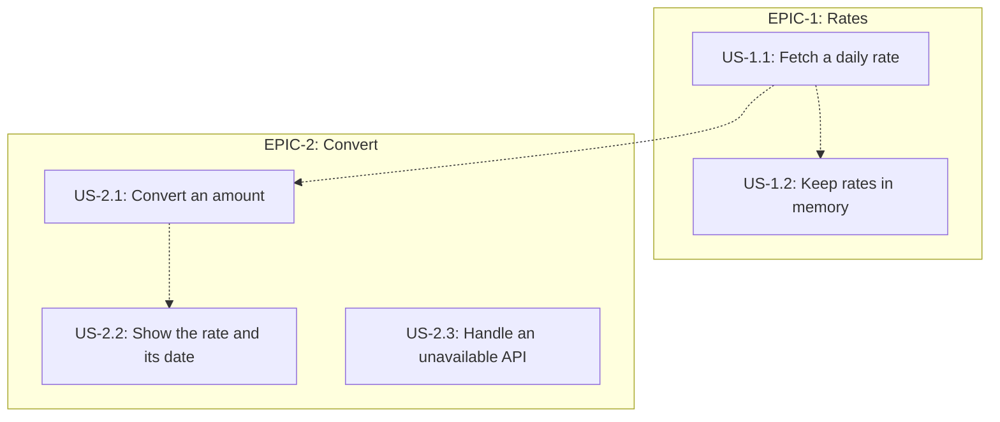
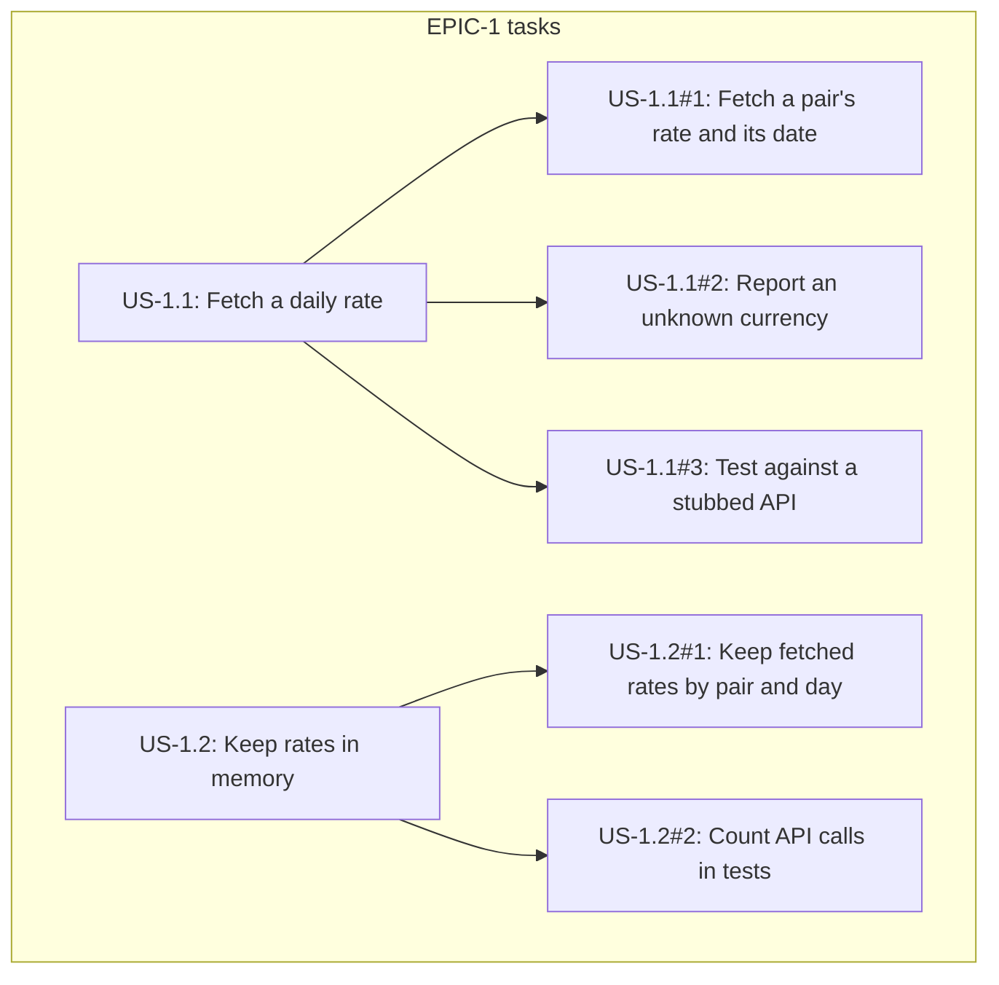
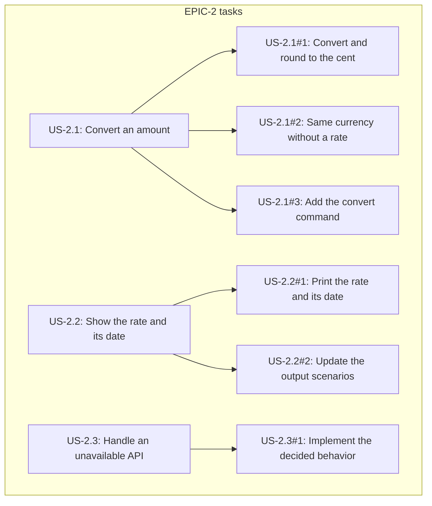

# SPECS — Currency Converter

CODEBASE Context: consumed (fe7b6ae)

## Table of Contents

- [EPIC-1: Rates](#epic-1-rates)
  - [US-1.1: Fetch a daily rate](#us-11-fetch-a-daily-rate)
  - [US-1.2: Keep rates in memory](#us-12-keep-rates-in-memory)
- [EPIC-2: Convert](#epic-2-convert)
  - [US-2.1: Convert an amount](#us-21-convert-an-amount)
  - [US-2.2: Show the rate and its date](#us-22-show-the-rate-and-its-date)
  - [US-2.3: Handle an unavailable API](#us-23-handle-an-unavailable-api)

## Work Item Status

| ID | Title | Status | Parent |
|---|---|---|---|
| EPIC-1 | Rates | — | — |
| US-1.1 | Fetch a daily rate | DONE | EPIC-1 |
| US-1.1#1 | Fetch a pair's rate and its date | DONE | US-1.1 |
| US-1.1#2 | Report an unknown currency | DONE | US-1.1 |
| US-1.1#3 | Test against a stubbed API | DONE | US-1.1 |
| US-1.2 | Keep rates in memory | DONE | EPIC-1 |
| US-1.2#1 | Keep fetched rates by pair and day | DONE | US-1.2 |
| US-1.2#2 | Count API calls in tests | DONE | US-1.2 |
| EPIC-2 | Convert | — | — |
| US-2.1 | Convert an amount | DONE | EPIC-2 |
| US-2.1#1 | Convert and round to the cent | DONE | US-2.1 |
| US-2.1#2 | Same currency without a rate | DONE | US-2.1 |
| US-2.1#3 | Add the convert command | DONE | US-2.1 |
| US-2.2 | Show the rate and its date | DONE | EPIC-2 |
| US-2.2#1 | Print the rate and its date | DONE | US-2.2 |
| US-2.2#2 | Update the output scenarios | DONE | US-2.2 |
| US-2.3 | Handle an unavailable API | NEEDS CLARIFICATION | EPIC-2 |
| US-2.3#1 | Implement the decided behavior | TODO | US-2.3 |

## Dependency Diagram







## Product Context

This illustrative backlog follows `ohmyorch:spec-ingestor`, invoked through
`/ohmyorch:ingest-spec`. Its source is [PRD.md](PRD.md). The project was greenfield when
the stories were written; [CODEBASE.md](CODEBASE.md) now describes the delivered code.
The converter was built from these documents, one OpenSpec change per story, with
`/ohmyorch:deliver`; the walkthrough video "OhMyOrch 03"
shows the delivery. Its code and its `openspec/` record, including the archived changes
that the `Change:` lines name, are in this folder: see [README.md](README.md).

The converter calls Frankfurter, a free exchange-rate API of daily reference rates from
central banks, with no API key. Tests use a stubbed API so they are
repeatable and run offline; only a conversion run by a person calls the real API.

## Goals

Convert an amount between two currencies at today's reference rate, show which rate
was used and from which day, and call the API no more than needed.

## Non-Goals

A database or files, historical rates, accounts, API keys, and more than one pair per
command.

## Actors

A person at a terminal, and the Frankfurter rate API.

## Global Business Rules

- BR-001: A currency code is three letters; input is case-insensitive and shown in
  upper case.
- BR-002: A converted amount is rounded to the nearest cent; a half cent rounds up.
- BR-003: A rate fetched today is reused for the rest of the day while the program runs.
- BR-004: Converting a currency to itself needs no rate.

Source: [PRD product principles](PRD.md#6-product-principles).

## Non-Functional Requirements

- NFR-001: Memory only: no database and no files.
- NFR-002: No API key or account.
- NFR-003: Tests use a stubbed API, run offline and are repeatable.
- NFR-004: Node.js 20 or later with no dependencies.

Source: [PRD non-functional requirements](PRD.md#9-non-functional-requirements).

# EPIC-1: Rates

Get today's rate for a currency pair and keep it for the day. Covers FR-001 to FR-003.

### US-1.1: Fetch a daily rate

Status: DONE
Change: `openspec/changes/archive/2026-11-13-us-1-1-fetch-daily-rate/`

As a person converting money
I want today's rate for a currency pair
So that a conversion uses the current reference rate.

Source:
- [PRD functional requirements](PRD.md#8-functional-requirements), FR-001, FR-002.
- [PRD constraints](PRD.md#11-constraints-and-dependencies), the Frankfurter v2 rate endpoint.
- [PRD product principles](PRD.md#6-product-principles), BR-001.

Acceptance Criteria:

```gherkin
Scenario: Fetch today's rate for a pair
  Given the rate API returns 0.9022 for USD to EUR, dated 2026-11-14
  When I ask for the USD to EUR rate
  Then I get the rate 0.9022, dated 2026-11-14

Scenario: Accept lower-case currency codes
  Given the rate API returns 0.9022 for USD to EUR
  When I ask for the usd to eur rate
  Then the rate API is asked for USD to EUR

Scenario: Report an unknown currency code
  Given the rate API rejects XYZ as an invalid currency
  When I ask for the USD to XYZ rate
  Then I get the error "Unknown currency: XYZ"
  And no rate is returned
```

Dependencies:
- None

Tasks:
- [x] Fetch a pair's rate and its date from the Frankfurter v2 rate endpoint
- [x] Report an invalid currency as "Unknown currency: <CODE>"
- [x] Cover the scenarios with tests against a stubbed API

Open Questions:
- None

### US-1.2: Keep rates in memory

Status: DONE
Change: `openspec/changes/archive/2026-11-13-us-1-2-keep-rates-memory/`

As a person converting money
I want a rate I already fetched today to be reused
So that the converter does not call the API again for the same pair.

Source:
- [PRD functional requirements](PRD.md#8-functional-requirements), FR-003.
- [PRD product principles](PRD.md#6-product-principles), BR-003.
- [PRD non-functional requirements](PRD.md#9-non-functional-requirements), NFR-001.

Acceptance Criteria:

```gherkin
Scenario: Reuse a rate on the same day
  Given the USD to EUR rate was fetched today
  When I ask for the USD to EUR rate again the same day
  Then the rate API has been called once

Scenario: Fetch again on a new day
  Given the USD to EUR rate was fetched yesterday
  When I ask for the USD to EUR rate today
  Then the rate API is called again
```

Dependencies:
- US-1.1

Tasks:
- [x] Keep fetched rates in memory, by pair and day
- [x] Count rate API calls in tests to show the second request uses memory

Open Questions:
- None

# EPIC-2: Convert

Convert an amount and show where the rate comes from. Covers FR-004 to FR-006.

### US-2.1: Convert an amount

Status: DONE
Change: `openspec/changes/archive/2026-11-13-us-2-1-convert-amount/`

As a person converting money
I want to convert an amount between two currencies
So that I know what it is worth in the other currency.

Source:
- [PRD functional requirements](PRD.md#8-functional-requirements), FR-002, FR-004.
- [PRD core workflow](PRD.md#7-core-workflow).
- [PRD product principles](PRD.md#6-product-principles), BR-002, BR-004.

Acceptance Criteria:

```gherkin
Scenario: Convert and round to the cent
  Given the USD to EUR rate is 0.9022
  When I run convert 20 USD EUR
  Then it prints "18.04 EUR"

Scenario: Round a half cent up
  Given the USD to EUR rate is 0.90225
  When I run convert 20 USD EUR
  Then it prints "18.05 EUR"

Scenario: Same currency needs no rate
  Given the rate API is available
  When I run convert 20 USD USD
  Then it prints "20.00 USD"
  And the rate API is not called

Scenario: Unknown currency
  Given the rate API rejects XYZ as an invalid currency
  When I run convert 20 USD XYZ
  Then it prints "Unknown currency: XYZ" and exits with status 1
```

Dependencies:
- US-1.1

Tasks:
- [x] Convert an amount at the pair's rate, rounded to the cent
- [x] Return the amount for the same currency without calling the rate API
- [x] Add the command: convert <amount> <from> <to>

Open Questions:
- None

### US-2.2: Show the rate and its date

Status: DONE
Change: `openspec/changes/archive/2026-11-13-us-2-2-show-rate-date/`

As a person converting money
I want to see the rate and its date with the result
So that I know where the number comes from and how current it is.

Source:
- [PRD functional requirements](PRD.md#8-functional-requirements), FR-005, which changes the output required by FR-004.

Acceptance Criteria:

```gherkin
Scenario: Show the rate and its date
  Given the USD to EUR rate is 0.9022, dated 2026-11-14
  When I run convert 20 USD EUR
  Then it prints "18.04 EUR (1 USD = 0.9022 EUR on 2026-11-14)"

Scenario: Same currency says no rate was used
  Given the rate API is available
  When I run convert 20 USD USD
  Then it prints "20.00 USD (same currency, no rate needed)"
```

Dependencies:
- US-2.1, whose conversion output this story changes

Tasks:
- [x] Print the rate and its date after the converted amount
- [x] Update the conversion output scenarios and their tests

Open Questions:
- None

### US-2.3: Handle an unavailable API

Status: NEEDS CLARIFICATION

As a person converting money
I want a defined result when the rate API does not answer
So that I know whether a number can be trusted.

Source:
- [PRD functional requirements](PRD.md#8-functional-requirements), FR-006.
- [PRD open questions](PRD.md#13-open-questions), OQ-001.

Acceptance Criteria:

```gherkin
Scenario: The rate API is unavailable
  Given the rate API does not answer
  When I run convert 20 USD EUR
  Then the result is not decided yet (OQ-001)
```

Dependencies:
- None

Tasks:
- [ ] Implement the decided behavior once OQ-001 is answered

Open Questions:
- OQ-001: When the API is unavailable, should the converter use the last known rate
  (and say how old it is), or refuse with an error?
